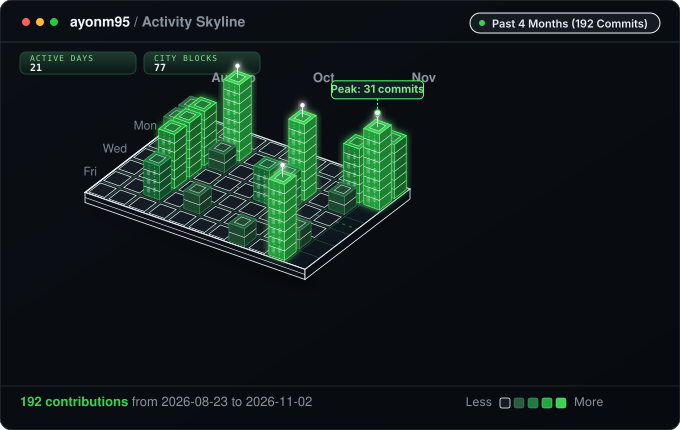

<div align="center">



<br/>

[](https://sepolia.etherscan.io/address/0x3f8E34B3D371253B47704bf1e1938a8dc01007Cc)
[-brightgreen?style=flat-square&logo=hardhat&logoColor=white)](https://github.com/ayonm95/pharmatree)
[](https://github.com/ayonm95/sonder-web3-fintech)
[](https://www.typescriptlang.org)
[](https://soliditylang.org)

</div>

---

<div align="center">

### `ayon@mesh:~$ cat about.md`

**Backend Engineer · Web3 Architect**

Bengaluru, India &nbsp;|&nbsp; MSc. Computer Science and Applications — Christ University &nbsp;|&nbsp; MCA — Amity University Noida &nbsp;|&nbsp; BCA — Christ University

</div>

---

### `$ cat stack.json`

```json
{
  "web3":     ["Solidity", "Hardhat", "Ethers.js", "EIP-712", "Sepolia", "Polygon Amoy"],
  "backend":  ["Java", "TypeScript", "Node.js", "PostgreSQL", "MongoDB", "Python"],
  "systems":  ["Swift 5.9+", "SwiftUI", "IOKit", "AppleSMC", "macOS Architecture"],
  "mobile":   ["Flutter", "Dart", "Firebase", "Cloud Firestore"],
  "ai_ml":    ["Agentic Swarms", "Groq 120B CoT", "Vector Stores", "LLM Pipelines"],
  "devops":   ["Git", "Docker", "GitHub Actions", "Google Cloud", "Google Maps Platform"]
}
```

---

### `$ ls -la projects/`

| Repository | Architecture & Stack | Key Achievements & Proof-of-Work |
|---|---|---|
| <nobr>&nbsp; **[PharmaTree](https://github.com/ayonm95/pharmatree)**</nobr> | Solidity · Hardhat · Next.js · EVM | Decentralized pharmaceutical supply chain with 5-tier packaging provenance, anti-counterfeit QR checks, **89/89 Hardhat & invariant tests (156 automated tests, 100% green)**, and Sepolia contract verification. |
| <nobr>&nbsp; **[Sonder](https://github.com/ayonm95/sonder-web3-fintech)**</nobr> | TypeScript · Merkle Trees · Polygon Amoy | Production-grade Web3 & FinTech royalty engine featuring Web Audio streaming, **GAAP double-entry ledger**, EIP-712 gasless rights attestation, and cryptographic Merkle payouts. |
| <nobr>&nbsp; **[QuizGenius](https://github.com/ayonm95/quizgenius-extension)**</nobr> | JavaScript · Manifest V3 · Groq API | AI-powered MCQ & quiz reasoning assistant with **Groq 120B Chain-of-Thought (CoT)** reasoning, automated DOM parsing, and Moodle LMS automation. |
| <nobr>&nbsp; **[Nightowler](https://github.com/ayonm95/nightowler)**</nobr> | Swift 5.9+ · SwiftUI · IOKit · AppleSMC | Autonomous macOS nocturnal clamshell guardian engineered in native Swift for AI agents and background workloads with **IOKit kernel power assertions**, direct AppleSMC hardware fan telemetry, and verified zero-sleep lid closure. |
| <nobr>&nbsp; **[Student ERP](https://github.com/ayonm95/student-erp)**</nobr> | Node.js · Express · MongoDB Atlas · React | Full-stack academic ERP system with secure **JWT authentication**, role-based access control (Admin & Student portals), and real-time student record management. |
| <nobr>&nbsp; **[FitMe](https://github.com/ayonm95/fitme-mobile-app)**</nobr> | Flutter · Dart · Firebase · Cloud Firestore | Cross-platform personal health and workout tracker with **Firebase Auth**, real-time Firestore sync, and kinetic mobile UI. |

---

###  `$ activity`

<div align="center">



</div>

---

<div align="center">

###  `$ ./connect`

[](https://linkedin.com/in/ayon-moitra)
[](mailto:ayonmoitra57@gmail.com)
[](https://github.com/ayonm95)

</div>
